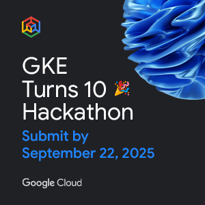
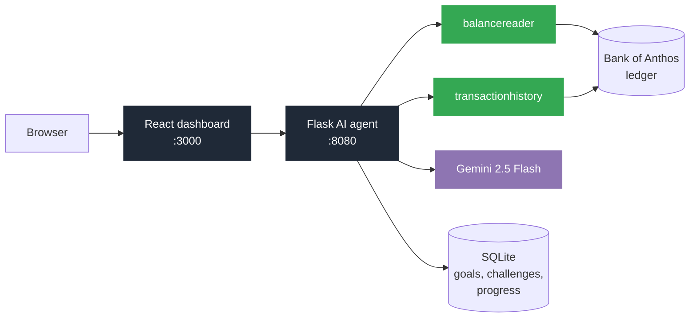
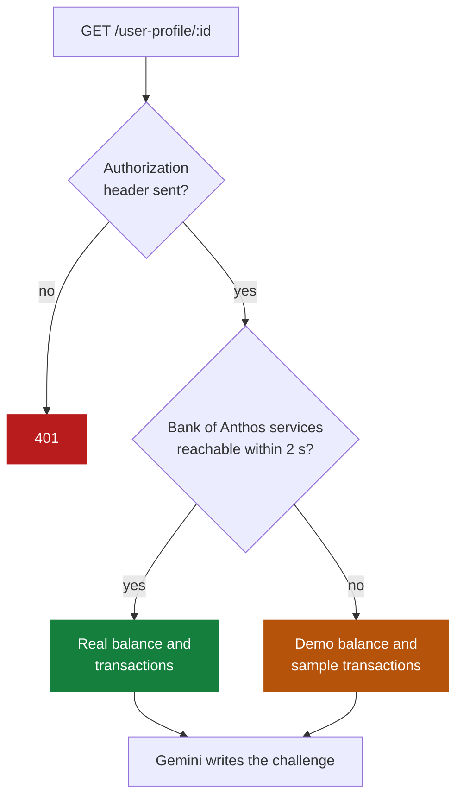
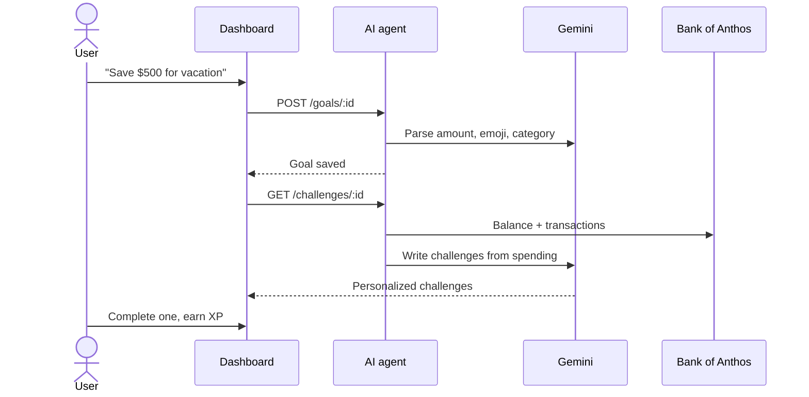

<p align="center">
  <picture>
    <source media="(prefers-color-scheme: dark)" srcset="src/ai-agent/frontend/public/brand/bankquest-logo-white.png">
    
  </picture>
</p>

<h1 align="center">BankQuest: AI Financial Coach</h1>

<p align="center">Gemini-powered savings challenges, added as a new microservice to Google's Bank of Anthos on GKE.</p>

<p align="center">
  <a href="https://gketurns10.devpost.com/"></a>
  <a href="https://www.youtube.com/watch?v=V7F3svisXFk"></a>
  <a href="https://devpost.com/software/bankquest"></a>
  <a href="https://github.com/comp-Ryan/gke-hackathon-Financial-Coach/actions/workflows/terraform-validate-ci.yaml"></a>
  <a href="LICENSE"></a>
</p>
<p align="center">
  
  <a href="https://github.com/GoogleCloudPlatform/bank-of-anthos"></a>
  <a href="https://ai.google.dev"></a>
  
  
  
</p>

<p align="center">
  <a href="https://gketurns10.devpost.com/"></a><br/>
  <sub>Built for the <a href="https://gketurns10.devpost.com/">GKE Turns 10 Hackathon</a> · Google Cloud · Sep 2025 · <a href="https://devpost.com/software/bankquest">Devpost entry</a></sub>
</p>

<p align="center"><b>Contributors</b></p>
<div align="center">
<table>
  <tr>
    <td align="center"><a href="https://github.com/comp-Ryan"></a><br/><sub><b>Ryan</b></sub><br/><sub><a href="https://github.com/comp-Ryan">@comp-Ryan</a></sub></td>
  </tr>
</table>
</div>

My part of this repo is the `src/ai-agent/` service. Everything else (accounts, ledger, frontend, Terraform, Kubernetes manifests) comes from Google's [Bank of Anthos](https://github.com/GoogleCloudPlatform/bank-of-anthos) sample, which is why the commit history has many other contributors.

## What This Does

- 🤖 **AI-Powered Challenges**: Uses Google Gemini to create personalized financial challenges
- 💰 **Goal Tracking**: Set and track financial goals with progress bars
- 📊 **Financial Insights**: Shows your balance, transactions, and spending patterns
- 🎯 **Achievement System**: Earn XP and unlock achievements
- 🔥 **Streaks and leaderboard**: daily streak messages and leaderboard context, written by Gemini
- 🏦 **Bank connection**: reads the real Bank of Anthos balance and history when it runs in the cluster, and falls back to demo data locally

## How it fits together



## Where the numbers come from



## Setting a goal



## Quick Start

### Prerequisites
- Python 3.10+
- Node.js 18+
- Google Gemini API key

### Step 1: Get Your Gemini API Key
1. Go to [Google AI Studio](https://makersuite.google.com/app/apikey)
2. Create a new API key
3. Copy the key (you'll need it later)

### Step 2: Run the Backend
```bash
# Navigate to backend folder
cd src/ai-agent/backend

# Install Python dependencies
pip install -r requirements.in

# Create environment file
echo "GEMINI_API_KEY=your_api_key_here" > .env

# Run the backend
python main.py
```
Backend will start on: http://localhost:8080

### Step 3: Run the Frontend
```bash
# Open new terminal, navigate to frontend folder
cd src/ai-agent/frontend

# Install Node.js dependencies
npm install

# Run the frontend
npm start
```
Frontend will start on: http://localhost:3000

### Step 4: Use the App
1. Open http://localhost:3000 in your browser
2. The app will automatically connect to the backend
3. Try setting a financial goal like "Save $500 for vacation"
4. Get AI-generated challenges based on your goal

## Project Structure

```
src/ai-agent/
├── backend/           # Flask API + AI
│   ├── main.py       # Main server
│   ├── gemini_client.py  # AI integration
│   └── database.py   # Data storage
├── frontend/         # React app
│   ├── src/components/  # UI components
│   └── src/services/    # API calls
└── k8s/             # Kubernetes files (optional)
```

## Configuration

### Backend Environment Variables
Create a `.env` file in `src/ai-agent/backend/`:
```bash
GEMINI_API_KEY=your_gemini_api_key_here
```

### Frontend Environment Variables
The frontend automatically connects to `http://localhost:8080` for the backend.

## API Endpoints

- `GET /user-profile/{user_id}` - Get user financial info
- `GET /challenges/{user_id}` - Generate AI challenge
- `POST /goals/{user_id}` - Set financial goal
- `GET /goals/{user_id}` - Get current goal
- `GET /achievements/{user_id}` - AI-written badges and milestones
- `GET /streak-message/{user_id}` - Daily streak message
- `GET /leaderboard-context/{user_id}` - Leaderboard insight
- `GET /additional-tasks/{user_id}` - Quick micro-tasks
- `POST /generate-emoji` - Pick an emoji for a goal
- `GET /ready`, `GET /version` - Health and version

## Demo Mode

The app runs in demo mode by default with fake data:
- User ID: `demo_user`
- Balance: $1,500
- Sample transactions included

## Troubleshooting

**Backend won't start?**
- Check if port 8080 is available
- Make sure you have the Gemini API key set

**Frontend can't connect?**
- Ensure backend is running on port 8080
- Check browser console for errors

**AI challenges not working?**
- Verify your Gemini API key is correct
- Check backend logs for API errors

## Tech Stack

- **Backend**: Python + Flask + SQLite
- **Frontend**: React + Axios
- **AI**: Google Gemini 2.5 Flash
- **Database**: SQLite

## License

Apache 2.0, inherited from Bank of Anthos (see [LICENSE](LICENSE)). Built for the GKE Turns 10 Hackathon.